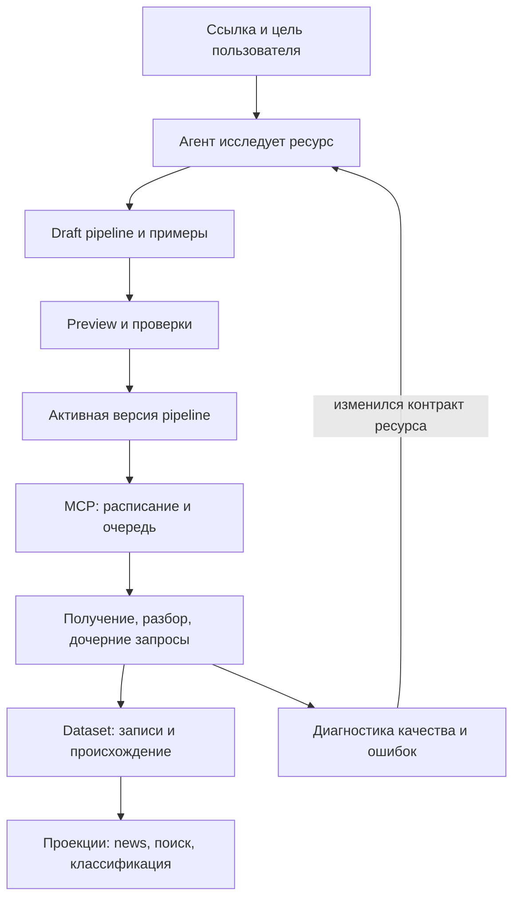

# Data Sources — исследование и предложение дизайна

**Status:** pending
**Priority:** P3
**Area:** mcp / data sources / pipeline runtime / agent authoring
**Created:** 2026-10-16

> **Итог обсуждения, 2026-10-16:** выбран runtime на стороне агента поверх
> текущего workflow, с durable state, ожиданиями и пользовательским вводом.
> MCP предоставляет инструменты, datasets и доставку событий; workflow DSL
> и checkpoints ему неизвестны. Актуальные требования: [durable workflows](durable-workflows.md)
> и [data sources](data-sources.md). Ниже сохранён ход исследования и прежние
> предложения, включая executor в MCP; они не являются актуальным решением.

## Context

Пользователь даёт ссылку/сайт и цель сбора. Агент исследует ресурс,
определяет способ получения и хранения данных, проверяет его и настраивает
регулярный сбор. Получение может требовать нескольких запросов и этапов.
Jev рассматривается как необязательный компонент выбора стратегии.

Это предложение для обсуждения, не утверждённый контракт и не реализация.
Исследованы первичные документы проектов и текущий код. Нагрузочных
испытаний, сравнительного прогона библиотек и новых вызовов Jev не было.
Ссылки проверены 2026-10-16. Основная задача: [data-sources](data-sources.md).

Рекомендация: **агент создаёт и проверяет версионированный pipeline;
MCP исполняет его по расписанию; агент возвращается при изменении ресурса
или цели.** Jev может помогать при настройке и в отдельных семантических
преобразованиях. Базовый сбор не зависит от доступности моделей.
Новостные embeddings остаются отдельной опциональной модельной операцией:
«без LLM на каждом тике» не означает, что существующая news-проекция
перестаёт вызывать embedding API.

## Что показало исследование

| Подход | Подтверждённая возможность | Вывод для нас |
| --- | --- | --- |
| Airbyte Connector Builder | AI Assistant настраивает endpoint, pagination, primary key, extraction и incremental sync, после чего конфигурация тестируется. [Документация](https://docs.airbyte.com/platform/connector-development/connector-builder-ui/ai-assist) | Агент может быть автором коннектора. Проверяемый manifest — полезный результат его работы. |
| Airbyte partitioning | Дочерние запросы могут брать ключи из родительского потока; partitioning отделён от pagination. [Документация](https://docs.airbyte.com/platform/connector-development/connector-builder-ui/partitioning) | «Список → детали» и «следующая страница списка» нужны как разные операции. |
| dlt REST API source | Декларативно описываются ресурсы, зависимости endpoint от полей родителя, pagination и incremental loading. [Документация](https://dlthub.com/docs/dlt-ecosystem/verified-sources/rest_api/basic) | Многоступенчатое получение не требует модели между запросами. |
| Crawl4AI | CSS/XPath extraction; модель может один раз сгенерировать схему для последующего извлечения без LLM. [Документация](https://docs.crawl4ai.com/extraction/no-llm-strategies/) | Подход применим к HTML, а не только к API. Схему нужно проверять на независимых примерах. |
| Crawlee | RequestQueue хранит задания обхода и различает их по uniqueKey, по умолчанию производному от URL. [Документация](https://crawlee.dev/js/api/core/class/RequestQueue) | Отдельно учитывать идентичность запроса и идентичность бизнес-записи; один URL нужно опрашивать многократно. |
| Temporal | Workflow отделён от Activities; Activities могут повторяться, поэтому их эффекты должны быть идемпотентны. [Документация](https://docs.temporal.io/activity-definition) | Надёжность достигается persisted work + idempotent commit, а не обещанием однократного HTTP-вызова. |
| TypeSafe/Jev | Типизированные choice/score/noul; выбор из заданных вариантов, без генерации селекторов, URL или программ. [Разбор API](https://openrouter.ai/blog/insights/what-is-jev/) | Подходит для ранжирования кандидатов и семантических решений; генератор кандидатов и исполнитель остаются нашей задачей. |

### Брать готовый продукт или делать свой слой

Это инженерная оценка для нашего проекта, а не результат бенчмарка:

- **Airbyte** имеет близкую модель коннекторов, но принятие платформы
  добавит отдельный эксплуатационный контур. Рассматривать, если нужны
  многие готовые интеграции, сложная авторизация и warehouse sync.
- **dlt** — наиболее интересная альтернатива собственному API-reader, если
  преобладают REST API. Интеграционный spike должен проверить Python worker,
  управление состоянием, запись в наши datasets и границу guarded HTTP.
  Не считать всю конфигурацию dlt безопасной декларацией: custom hooks могут
  содержать исполняемый Python. Поддерживаемое подмножество надо ограничить.
- **Crawl4AI/Crawlee** — кандидаты на отдельный web/browser worker, если
  появится много сайтов с JS. Они не заменяют нашу модель source/dataset,
  расписание и интеграцию с агентом.
- **Temporal** — кандидат при длинных workflow, распределённых workers и
  сложной координации. Для коротких ограниченных ingestion jobs предлагается
  PG-очередь. Не воспроизводить Temporal event replay и универсальную
  оркестрацию внутри собственной DSL.
- **Свой узкий Rust runtime** лучше соответствует текущему MCP и единому
  JSONB-хранилищу. Цена выбора — мы владеем pagination, recovery и тестами.
  Решение пересмотреть после корпуса реальных источников, до расширения
  на браузерные сессии, авторизацию и сложные вычисления.

## Промежуточное предложение: executor независимо от harness

Последующее обсуждение расширяет конструктор до общих процессов с
LLM-шагами. Предложение «каждый запрос рассуждения отправляется сигналом
нашему агенту, который возвращает callback» для обычной генерации избыточно.
Рекомендуется разделить автора процесса, runtime и реализации операций.
Это уточнение заменяет предположение ниже о размещении всех вызовов моделей
исключительно в agent-процессе; решение ещё обсуждается.

- **Автор** — любой агент с MCP-доступом: создаёт datasets/process versions,
  проверяет, активирует, инспектирует. Автору не нужен отдельный интеграционный
  протокол исполнения, и его сессия не требуется для работы cron.
- **Runtime** — DSL, bindings, control flow, durable run state, расписание и
  каталог операций. Core не зависит от `Engine`, skills или конкретной LLM.
  Его MCP-интерфейс служит управлению. Физически runtime может сначала жить
  в MCP-процессе; отдельный сервис для этой границы не обязателен.
- **Операции** — вызовы через узкий внедрённый интерфейс, например
  `invoke(operation, input, context) -> result`. Context несёт execution key,
  cancellation/deadline и tracing. Каждый оператор объявляет input/output,
  версию, эффект и retry policy. Handler может быть локальной функцией,
  API-клиентом или адаптером внешнего исполнителя.

Обычная модельная операция: `llm.generate(profile, instructions, input,
outputSchema) -> value`. Она вызывает provider API напрямую и проверяет
ответ. Для executor это такой же await, как HTTP или dataset query.
`decision.classify` с Jev — ещё одна операция с собственным typed-контрактом.
Profiles выбираются конфигурацией runtime; фактическая модель/версия и usage
сохраняются с результатом. Неподдерживаемые capabilities проверяются при
валидации процесса, а не молча эмулируются.

Полноценная делегация: `agent.run(profile, task, input, outputSchema)`.
Нужна только когда шаг должен самостоятельно искать решение и пользоваться
инструментами/памятью. Для нашего Engine и каждого внешнего harness будет
адаптер к его реальному API/CLI; нельзя обещать нулевую обвязку и одинаковую
семантику любого агента. Эта зависимость локализована в одной операции.
Замена агента-автора процесса такого адаптера не требует.

У шага простой request/result API, но recovery остаётся обязанностью runtime:
сохранить intent, вызвать handler, сохранить результат, продолжить. Crash
после ответа модели, но до commit может привести к повторному платному
вызову; произвольный провайдер не гарантирует exactly-once. Сохранённый
результат повторно не генерируется. Agent/tool steps с внешними эффектами
не должны получать автоматический retry только потому, что являются await.
Настоящие длительные внешние jobs могут иметь submit/poll внутри адаптера;
callback/signal контракт вводится только при такой необходимости.

MCP sampling проверен как альтернатива: в спецификации 2026-07-28 он
помечен deprecated; новые реализации должны использовать прямые provider
API. Кроме того, описанный sampling flow обслуживает запрос клиента и
зависит от его capability. Не делать его обязательной опорой автономных
cron jobs. [Спецификация MCP sampling](https://modelcontextprotocol.io/specification/2026-07-28/client/sampling).

Точка рефакторинга существующего workflow — зависимость
`WorkflowRunner.engine: Arc<Engine>` в `crates/agent/src/workflow.rs`.
DSL/executor могут обращаться к operation interface; `llm_compose`, `decide`
и `llm_agent` реализуются адаптерами. Compiler остаётся у агента-автора.
Переиспользовать существующий опыт, но отдельно добавить durable state:
нынешний executor не становится устойчивым к рестарту от одной замены DI.
Не импортировать agent crate в MCP ради доступа к Engine.

## Исторический вариант: runtime в MCP



Три разные работы:

1. **Настройка.** Агент исследует API/HTML, сравнивает кандидатов, создаёт
   manifest, проверяет семплы и активирует конкретную версию.
2. **Исполнение.** MCP делает ограниченный граф операций, сохраняет
   промежуточную работу и результат. На обычном тике нет planner/LLM.
3. **Обслуживание.** Повтор сетевых ошибок выполняет код. При устойчивом
   нарушении контракта MCP создаёт один дедуплицированный сигнал диагностики;
   агент предлагает новую версию, прогоняет fixtures и live preview.

Самоисправление не меняет активную конфигурацию незаметно: новая версия
проходит те же проверки, сохраняется diff и причина. Автоактивация возможна
для исправлений в прежних границах источника и цели; смена dataset, ключа,
семантики данных или credentials является отдельным изменением настройки.
Не вводить обязательное ручное подтверждение каждого исправления.

## Что сохраняет агент

Разделить четыре сущности, не смешивая mutable runtime state с конфигурацией:

| Сущность | Содержание |
| --- | --- |
| Source | Пользовательская цель, исходная ссылка, dataset, период, lifecycle, ссылка на активную версию |
| PipelineVersion | Неизменяемый manifest: получение, разбор, fan-out, mapping, key, ограничения, checks; версия DSL и hash |
| Run / WorkItem | Запуск и durable задания по страницам/элементам, attempts, lease, input/output refs, ошибки и checkpoints |
| Dataset / Projection | JSONB-записи с revision/provenance; отдельное материализованное представление |

Предлагается пересмотреть прежнее разделение источников и данных между
двумя БД: **новый data-sources домен целиком хранить в content PG**, включая
свои расписания, pipeline versions, work items, checkpoints и outbox.
Это позволяет атомарно активировать конфигурацию и фиксировать
`records + next work + progress`. MCP остаётся владельцем обеих БД;
существующие signals/scheduled_tasks/credentials остаются в `mcp_state`.

Сигнал ремонта доставляется из content outbox в очередь `mcp_state` с
идемпотентным event ID; это отдельная межбазовая граница. Без обработки
агентом регулярный сбор остальных источников продолжает работать.
При сохранении прежнего split потребуется описанный в основной задаче
протокол неактивного создания и recovery между БД; это рабочий, но более
сложный вариант. Перенос нового домена — рекомендация, не выполненная миграция.

## Минимальный язык pipeline

Не нужен произвольный набор MCP-tools внутри фонового графа. Нужен каталог
операторов с типами входов/выходов, версиями, примерами и явными лимитами.
Предлагаемый набор:

| Оператор | Назначение |
| --- | --- |
| `http.get` | Ограниченный GET через guard; status, final URL, headers, body ref |
| `parse.feed/json/html` | Разбор RSS/Atom, JSON и статического HTML |
| `select/map/filter` | JSON Pointer, CSS, извлечение атрибутов/текста, сравнение, coalesce, даты, URL resolve |
| `paginate` | next link/token, page/offset; предел страниц/времени, обнаружение цикла |
| `for_each` | Дочерний запрос/подграф для каждой записи с ограниченной конкурентностью |
| `switch` | Ветвление по status/type/наличию поля; только объявленные ветви |
| `article.extract` | Readability с явно настроенным fallback |
| `emit` | Запись в конкретный dataset с key/write mode и постановка проекций |

Статический граф ацикличен; повторение допускается только внутри
ограниченных `paginate`/`for_each`. Большие ответы передаются по handles,
не сериализуются в контекст агента. Операторы не могут вызвать shell,
передать произвольный SQL или выбрать произвольный MCP-tool.

JSON Pointer годится для адреса поля; это не язык преобразований.
Начать с малого типизированного AST для coalesce, string/date conversion,
URL resolution и сравнений. Не накапливать десятки уникальных строковых
шаблонов. Если корпус покажет сложные преобразования, отдельно выбрать
готовый язык выражений с ограничениями исполнения или code extension.

HTML можно разбирать в Rust через
[`scraper`](https://docs.rs/scraper/latest/scraper/), который предоставляет
HTML parsing и CSS selectors. Это кандидат, не выбранная зависимость.
Новые браузерные возможности не считать уже имеющимися.

### Пример многоступенчатого получения

Сайт публикаций: API списка → несколько страниц → для каждого ID запрос
деталей → при отсутствии body загрузка страницы → normalise → dataset.
Ни один переход сам по себе не требует модели.

Ниже иллюстрация предлагаемой формы, **не существующий API/валидная
утверждённая схема**. Имена endpoint условные, `${…}` — ссылки на bindings.

```yaml
version: 1
source: example-publications
dataset: publications
schedule: { every: 30m }
limits: { requests: 120, pages: 5, concurrency: 4, duration: 2m }
steps:
  - id: listing
    op: http.get
    url: https://example.org/api/posts
    paginate: { kind: next_link, pointer: /next }
    records: { parse: json, pointer: /items }
  - id: details
    op: for_each
    input: ${listing.records}
    bind: item
    steps:
      - id: detail
        op: http.get
        url_template: https://example.org/api/posts/{id}
        path_params: { id: "${item.id}" }
      - id: body
        op: switch
        when: { present: "${detail.json.body}" }
        then: { value: "${detail.json.body}" }
        else:
          op: article.extract
          url: ${detail.json.url}
      - op: emit
        key: ${item.id}
        payload:
          title: ${detail.json.title}
          url: ${detail.json.url}
          body: ${body}
          published_at: ${detail.json.published_at}
```

Runtime кодирует path/query-параметры и проверяет каждый результирующий
URL. Предел запросов относится ко всему run, включая страницы, fan-out
и retries; превышение даёт partial с сохранённой работой, не fake success.
Синтаксический сахар разворачивается в один внутренний граф.

HN становится manifest `topstories → take → item/{id} → article/fallback`.
Совместимость требует сохранить старый URL-based news key при миграции,
даже если item ID удобнее для новых datasets. Habr — feed manifest.

## Надёжность и качество данных

- **Запрос и запись имеют разные ключи.** Work key включает run/version,
  step и partition/item/page; record key — `(dataset, source, externalId)`.
  URL не обязан быть ID записи, а обработанный URL не запрещён навсегда.
- **Checkpoint означает принятые обязательства.** Страница считается
  принятой, когда записи или дочерние jobs надёжно сохранены. Затем можно
  двигать её cursor. Детали, упавшие после этого, остаются отдельной работой,
  даже если элемент исчезнет из следующего top-N списка.
- **Progress и freshness различаются.** Чтение списка завершилось, а
  обогащение 3 записей ещё ожидается — это видимое состояние partial/pending.
  Ошибка одного дочернего запроса не уничтожает успешные соседние результаты.
- **Snapshot и incremental — разные режимы.** RSS/top-N обещает только
  наблюдаемый срез. API с cursor может обеспечивать более полный сбор в
  пределах своего контракта. Если страницы ограничены бюджетом, сохраняется
  продолжение. Page-token, watermark времени и ETag — разные виды state.
- **Mutable detail требует своей refresh policy.** Неизменный список не
  доказывает неизменность страниц деталей. Для append можно fetch-once;
  для upsert нужен updated_at/version из источника или refresh TTL.
  Удаление по отсутствию запрещено для неполного snapshot.
- **At-least-once + идемпотентная запись.** После сбоя HTTP может повториться.
  Commit проверяет lease generation и input/config revisions. Нельзя
  перезаписать новый результат старым или повторно создать ту же запись.
  Результаты успешно сохранённых шагов переиспользуются в пределах run;
  глобальный кэш — только по явной freshness policy.
- **Версии.** Run закреплён за pipeline version. Новые запуски берут новую;
  поздняя запись старого run не перекрывает уже применённую новую версию.
  Смена key/dataset — миграция, а изменение селектора — новая версия.
- **Данные и производные.** Dataset payload — долговечный результат;
  HTTP bodies для диагностики/fixtures имеют TTL и лимит хранения.
  Проекции сохраняют собственные версии и не уничтожают исходный payload.
  Для воспроизведения сохраняются использованные значения/refs, hashes и
  причины выбора ветвей. TTL body означает, что полный исторический replay
  после его истечения не гарантируется.
- **Обнаружение поломки.** Проверять parse success, ключи, долю пустых полей,
  распределение типов/количество записей и явные признаки login/error page.
  Ноль новых записей сам по себе нормален. Резкое изменение метрик — сигнал
  проверки, не автоматическое доказательство поломки или повод стереть данные.
- **Ремонт.** Backoff для сети; quarantine для невалидных записей;
  дедуплицированный repair signal при устойчивом schema drift. Ограничить
  количество автоматических попыток ремонта и модельный бюджет.

Conditional requests с ETag/Last-Modified полезны для экономии HTTP;
304 означает отсутствие нового тела ответа, а не пустой dataset.
Семантика определена в [RFC 9110](https://www.rfc-editor.org/rfc/rfc9110.html#name-if-none-match).
Текущий `Fetched` не отдаёт validators/Retry-After/Link headers, а `Fetch`
принимает только URL и timeout — для этого контракт придётся расширить.

Ограничения сети/размеров/конкурентности проверяет runtime для любого
кандидата, независимо от уверенности модели. Это касается и URLs из HTML,
redirects, next-page links и дочерних запросов. Credentials в manifest
допускаются только как ссылки на настроенные секреты, когда auth войдёт
в scope; agent env не передаётся сгенерированным шагам.

## Где полезен Jev

### 1. При настройке — выбор кандидата для следующей проверки

Сначала механические проверки: Content-Type, успешный JSON/XML parse,
`rel=alternate`, структура массива, JSON-LD, ссылки на документацию/API.
Не тратить модельный вызов на вопрос, который точно решает parser.

Агент или код составляет кандидатов с конкретными параметрами:
`rss:/feed.xml`, `json:/api/posts`, `html:article.card`.
Jev может выбрать наиболее подходящий цели, оценить тематическую
релевантность семпла или ранжировать уже извлечённые DOM-контейнеры.
При отсутствии подходящего варианта возвращается unknown/escalate.
Параметры/селекторы генерируются агентом либо перечислителем кандидатов;
Jev сам их текст не пишет.

### 2. В обработке — когда решение действительно зависит от смысла

Например: классифицировать документ как release note / вакансию / новость,
выбрать объявленную схему для смешанного потока или отметить рекламу.
Сохранить исходную запись до семантической фильтрации; label и вероятность
хранить как производные с model/question version. Сбой Jev не теряет сбор.
Для неизвестного класса — fallback/quarantine, не молчаливое удаление.

Это опциональная projection/enrichment capability. Результат кэшируется
по input hash + model version + question version. Для retry используется
сохранённое решение; новое решение не выдаётся за воспроизведение старого.
Сайт с одним устойчивым форматом не требует повторной классификации каждого
ответа. Смешанные форматы проверяются по записи/группе, а не одним семплом
на весь источник.

### 3. Более общая машина поиска решения

Возможна конструкция:

`state → available actions → Jev ranks → bounded probe → observed result
→ verifier → next state`, с fallback к большой модели при unknown.

Это эвристический поиск в пространстве программ/стратегий. Его полнота
ограничена генератором действий: отсутствующий правильный endpoint нельзя
выбрать, если никто его не нашёл. Жадный выбор одной ветки может пропустить
решение; нужны сохранённые кандидаты, попытка следующих вариантов и общий
бюджет. Проверка успеха — полученные данные и контракт, не уверенность Jev.

Для знакомых классов задач такой контроллер может уменьшить количество
дорогих planner-вызовов. Для первого подключения неизвестного сайта
предлагается использовать уже имеющегося агента, собирать traces/fixtures
и лишь затем выделять повторяющиеся решения в Jev. Создавать универсальный
solver до появления корпуса задач сейчас не предлагается.

`confidence` у TypeSafe выводится из распределения вариантов; это не
доказательство правильности результата и не автоматически вероятность
успеха целого pipeline. Пороги нужно проверять на нашем корпусе, отдельно
для разных вопросов. [Документация confidence](https://docs.typesafe.ai/confidence).
Существующий threshold новостного фильтра не переносится на выбор стратегии.

## Как использовать нынешний код

- [`news.rs`](../../crates/mcp/src/news.rs): article extraction, repository,
  embeddings и Telegram provider сохраняются; новый runtime не импортирует
  NewsItem, news projection реализует его интерфейс со стороны news.
- [`fetch.rs`](../../crates/mcp/src/fetch.rs): переиспользовать SharedFetch,
  guard и bounded reads; дополнить headers/request options.
- [`workflow.rs`](../../crates/agent/src/workflow.rs): полезный опыт bindings
  и tracing, но executor зависит от Engine/skills, а не является автономным
  durable ingestion runtime. Не исполнять его в MCP через прямой импорт.
- [`decisions.rs`](../../crates/agent/src/decisions.rs): уже есть typed
  choice/score/noul client. Workflow `decide` сейчас исполняет только filter.
  Выбор стратегии требует отдельного agent capability/вызова клиента.
- [`codex.rs`](../../crates/agent/src/codex.rs): code_agent вызывает модель,
  просит написать/выполнить код и вернуть результат. Это не registry
  сохранённых скриптов и не executor артефактов без LLM.
- Для onboarding/repair использовать существующий Jev client агента.
  В фоновых процессах модели могут вызываться через независимые operation
  adapters, как описано в уточнении выше. Credentials внедряются в host
  этих adapters; `.env.agent` не копируется целиком, agent runtime в MCP
  не импортируется. Базовый сбор модельных операций не требует.

### Когда декларации недостаточно

Зарезервировать extension interface для сохранённого versioned code
artifact: входные bytes/JSON → выходной JSON, timeout/memory limit,
без произвольного доступа к сети/БД. Сеть и запись остаются операторами
runtime. Агент пишет артефакт при настройке; на тике выполняется артефакт,
а не заново запускается code_agent.

Вариант sandbox — WASM/Wasmtime, но это отдельная инженерная работа.
Fuel/epoch и resource limits помогают ограничивать гостевой код;
блокирующие host calls требуют собственных timeout/cancellation.
[Документация Wasmtime](https://docs.rs/wasmtime/latest/wasmtime/struct.Config.html).
Не включать такой runtime в первую итерацию без источника, которому он нужен.

## Предлагаемый scope и проверка

Первый вертикальный срез должен покрывать:

1. RSS/Atom → dataset → news.
2. JSON list с pagination → detail → dataset.
3. Статический HTML list → detail → CSS/Readability extraction → dataset.
4. HN как композицию общих операторов, без отдельного специализированного reader.
5. Preview, activation, pause/resume, restart recovery и repair diagnostics.

Это шире предыдущего предложения v1 с одним JSON GET. Такая прибавка
соответствует пожеланию «сайт и многоступенчатые данные». Browser-only
сайты, login/session automation, произвольный код, универсальные DAG jobs
и обязательный Jev остаются за первой итерацией. Если источник требует JS,
агент фиксирует needs_browser, а не делает вид, что сайт подключён.

Перед окончательной фиксацией DSL собрать 15–20 источников/fixtures разных
типов, включая неподдерживаемые. Для каждого задать ожидаемые поля,
идентичность и полноту; часть страниц оставить вне настройки селекторов.

Сравнить на одинаковых входах и бюджетах:

| Вариант | Как настраивает | Как исполняет |
| --- | --- | --- |
| A — baseline | Агент + механические проверки | Один и тот же deterministic runtime |
| B — Jev-assisted | То же, Jev ранжирует кандидатов/стратегии | Тот же runtime |
| C — ограниченный solver | Библиотека кандидатов + Jev + fallback к агенту | Тот же runtime |

Метрики: доля корректно подключённых источников, полнота/точность полей
на отложенных страницах, цена/время настройки, число HTTP-запросов,
молчаливо неверные результаты, качество после изменения HTML/API,
цена ремонта. Успех = корректные данные после повторного тика и рестарта,
а не только один удачный preview. Отдельно измерять результат по типам
источников; общий процент на маленьком наборе не считать гарантией.

Обязательные fault cases: detail исчез между тиками, 429/Retry-After,
пустая страница, cycle next link, частичный batch, смена key/selector,
потеря lease, crash после сохранения child job, поздний embedding.
Preview должен показывать coverage и пропущенные ветви; три красивых записи
не доказывают полноту пагинации или поддержку всех форматов сайта.

## Исторический список изменений до итогового обсуждения

- Заменить fixed readers на catalog операторов + versioned pipeline;
  RSS и HN — готовые recipes поверх него.
- Включить bounded multi-step и HTML в первый рабочий scope.
- Выбрать размещение состояния нового домена: рекомендуется content PG.
- Сохранить datasets/projections и выявленные требования к revisions,
  идемпотентности, ключам, миграции новостей и embedding CAS.
- Добавить authoring/preview/activate и repair loop; отделить discovery
  от исполнения. Не путать data-source расписание с LLM scheduler signals.
- Jev оставить экспериментом с измеримым baseline, не prerequisite.

Связанные идеи: [JIT](agent-jit-workflows.md), [watch tasks](watch-tasks.md),
[Jev](jev-system-one.md). Общая идея «настроить один раз, повторять кодом»
совместима с ними; общий executor всех агентских задач пока не требуется.
