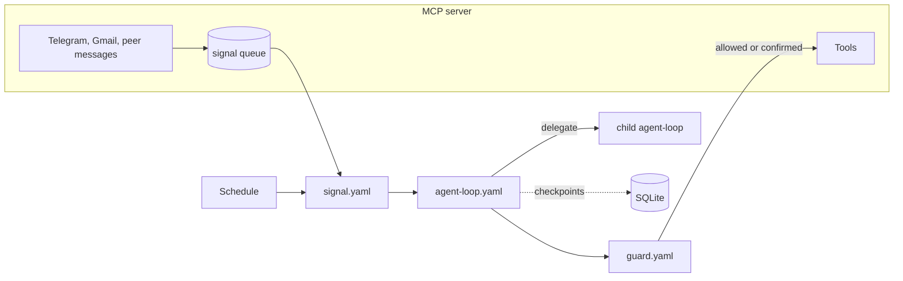

  

<h1 align="center">Ouro helper</h1>

  <b>A personal agent whose own loop is a workflow it can read, rewrite and resume.</b>

  
  
  
  
  

Ouro lives on a small server and works for one person. You talk to it in
Telegram; it also acts on its own when mail arrives, news breaks or a
scheduled task comes due. It decides how to handle each request, delegates
to sub-agents, remembers what matters, and turns routine work into its own
skills and workflows.

> 🚧 A personal project under active development. Interfaces change often.

## Highlights

- **The agent loop is a workflow.** Turn, review, tools, settle: the loop is
  [`agent-loop.yaml`](crates/agent/workflows/agent-loop.yaml), run by
  Ouro's own [Open Workflow Specification](https://open-workflow-specification.org/)
  interpreter ([`crates/owf`](crates/owf)). With your approval Ouro
  activates its own version of the loop, or of how a signal is handled,
  without a rebuild;
  three faults in a row restore the built-in one.
- **Durable.** Loops, sub-agents and saved workflows checkpoint every step
  to SQLite. A restart resumes them where they were; a run waiting for an
  event or a timer sleeps without holding a worker.
- **Guarded.** Every write and every call to the open internet is reviewed
  against what the user asked. Consequential ones wait for your tap on
  Confirm / Decline in Telegram; the run sleeps until you answer.
- **Self-improving.** Behaviour lives in plain-text skills and workflows
  Ouro reads and rewrites, not in code it can't change.
- **MCP all the way down.** The agent and its tools are separate processes
  that speak only the [Model Context Protocol](https://modelcontextprotocol.io).
  The same memory serves Ouro, Claude Code and ChatGPT.

## What it does for you

| | |
|---|---|
| 💬 **Telegram** | Answers and carries out requests, with the conversation as context. |
| 📰 **News** | Reads Hacker News, Habr and your Telegram channels; digests skip what you've seen. |
| 🧾 **Mail** | Notices bills in Gmail, reads the PDF, tells you what to pay. |
| 🧠 **Memory** | Projects, notes and facts, found by meaning, shared with your other AI tools. |
| ⏰ **Schedule** | Reminders, recurring checks and reports, set up in plain words. |
| 🤝 **Other agents** | Claude Code and others can message Ouro and get answers back. |

## How it works

1. A poller turns an incoming message, mail or peer request into a signal;
   the agent's own schedule fires the rest.
2. [`signal.yaml`](crates/agent/workflows/signal.yaml) gathers context
   (history, recent activity, the skills Jev picks for the request) and
   starts a loop, or runs a saved workflow.
3. [`agent-loop.yaml`](crates/agent/workflows/agent-loop.yaml) asks the
   model, has [`guard.yaml`](crates/agent/workflows/guard.yaml) review the
   calls, runs tools and child loops, and repeats until done.
4. Every side effect is a tool call, and every run is traced.

## Principles

- **The runtime informs; the agent decides.** The system gathers context
  but never acts on the agent's behalf. A reply is a tool call the agent
  chooses to make.
- **Behaviour in skills and workflows, not in Rust.** How to talk in a
  chat, when to delegate, what a digest looks like: all text Ouro can
  change.
- **General mechanisms over special cases.** Memory, skills, workflows and
  sub-agents, rather than a branch for one situation.

## Repository

| Crate | What it is |
|---|---|
| [`crates/mcp`](crates/mcp) | MCP server: Gmail, Telegram, news, memory and other tools, plus the pollers that emit signals. Knows nothing about the agent. |
| [`crates/agent`](crates/agent) | The supervisor: signals, loops, guard, schedule, durable runs. Reaches tools only over MCP. |
| [`crates/owf`](crates/owf) | Open Workflow Specification interpreter with a [durability contract](crates/owf/README.md). Independent of the rest. |
| [`crates/evals`](crates/evals) | Judges, golden sets (news filter, guard) and trace replay. |
| [`crates/codex`](crates/codex) | The sandbox for the agent's `code_agent` tool. |

## Docs

- [Architecture](docs/architecture.md): how the system is built.
- [Operations](docs/operations.md): running, testing, deploying.

Built in Rust with a lot of help from AI coding agents.
