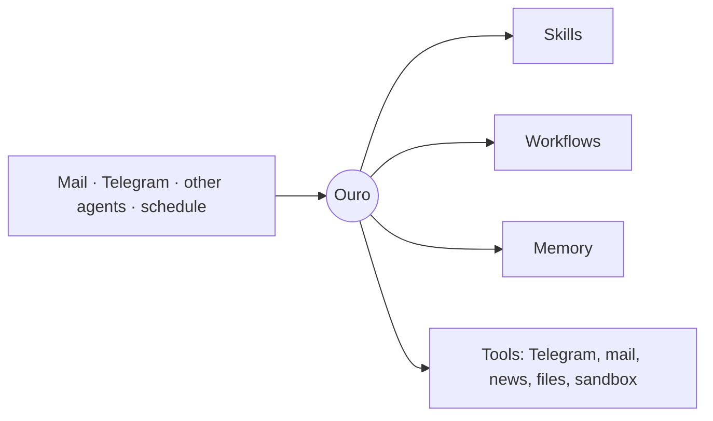

  

<h1 align="center">Ouro helper</h1>

> A personal agent that reads your mail, chats with you in Telegram, watches
> your news and channels, answers other agents, and remembers. Separate Rust
> processes that talk to each other only over the
> [Model Context Protocol](https://modelcontextprotocol.io).

  
  
  
  
  

> 🚧 **Work in progress.** This is a personal project under active
> development, and its interfaces and internals change often.

---

## Meet Ouro

Ouro is a personal agent that lives on a small server and works for one
person. You talk to it in Telegram the way you would talk to an assistant.
It also keeps an eye on things for you without being asked: bills arriving
by mail, news worth knowing, tasks you scheduled for later.

It is not a chatbot bolted onto a few APIs. Ouro decides how to handle each
request itself. It can delegate to sub-agents, write and run small
programs, remember what matters, and over time turn what it has learned
into new skills and automations of its own.

## What it does

| | |
|---|---|
| 💬 **Talks to you in Telegram** | Answers questions and carries out requests, using the conversation's history as context. |
| 📰 **Reads the news for you** | Collects Hacker News, Habr and the Telegram channels you follow, and sends digests that skip what you have already seen. |
| 🧾 **Handles your mail** | Notices utility bills in Gmail, reads the PDF and tells you what to pay. |
| 🧠 **Remembers** | Keeps projects, notes and facts in a memory it shares with your other AI tools, and finds them by meaning, not just by keywords. |
| ⏰ **Keeps time** | Reminders, recurring checks and scheduled reports, set up in plain words. |
| 🤝 **Works with other agents** | Other assistants, such as Claude Code, can message Ouro and get answers back. |

## It grows with you

Ouro's behaviour is written in plain-text **skills**: how to talk in a chat,
what a good digest looks like, when to hand work to a helper. Ouro can read
and rewrite its own skills. Ask it to change how it does something, and it
updates the skill instead of forgetting by the next conversation.

Routine work becomes **workflows**. When a task repeats, Ouro drafts a
workflow for it, tries it out safely first, shows you what it would do, and
then runs it on schedule. A workflow doesn't need a model to decide every
step, so it is cheaper and more predictable.

Every night Ouro looks back over its recent work and decides what to
improve in its own skills.

## The idea behind it

> **Give the agent as much freedom and generality as possible.**

The system around Ouro informs it and never acts on its behalf. Behaviour
lives in skills Ouro can change, not in code it can't. One general
mechanism, such as memory, skills, workflows or helpers, is always preferred
to a special case. The goal is an assistant that becomes more capable as it
learns, not one that is limited to the cases someone thought of in advance.

## How it fits together

Events arrive as signals. Ouro picks them up one at a time, decides what to
do, and acts only through tools. Everything it does is traced, so any
decision can be looked at afterwards.

## Learn more

- [Architecture](docs/architecture.md) explains how the system is built.
- [Operations](docs/operations.md) covers running it, tests and deployment.

A personal project, built in Rust with a lot of help from AI coding agents.
