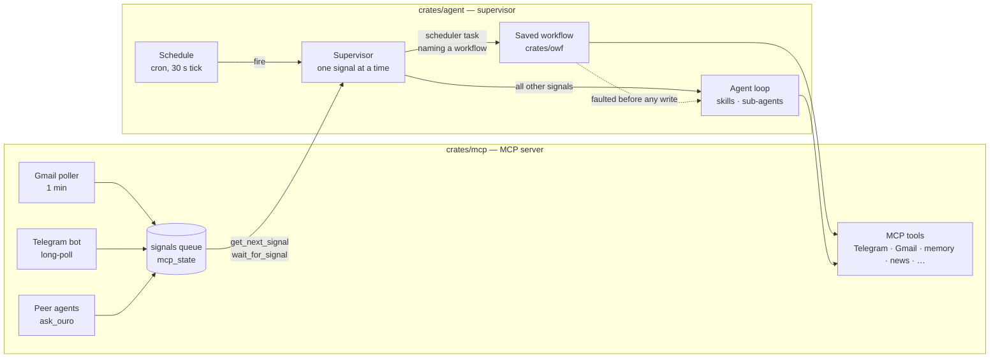
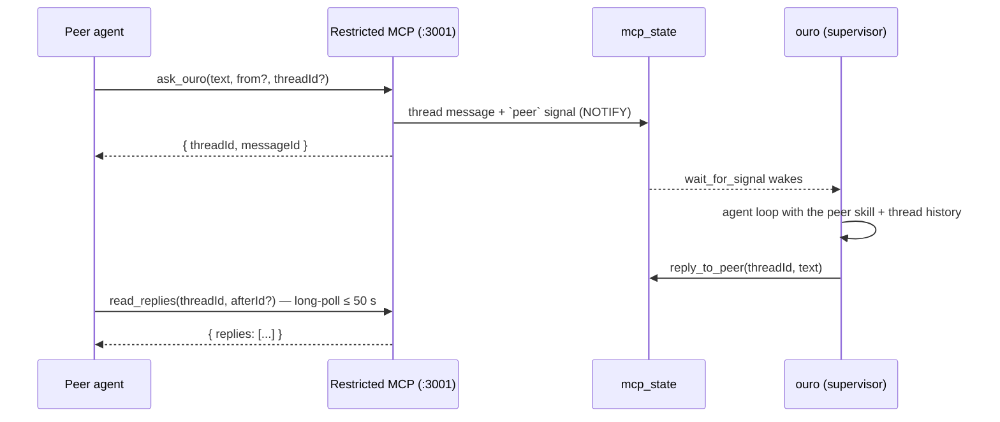

# Ouro: architecture

How the system is built: the crates, how a signal becomes action, skills,
saved workflows, memory, the MCP surface and peer messaging. Running, tests
and deployment are in [operations.md](operations.md).

## What it is

Ouro is a **signal-driven personal agent**. External events become
*signals*: a new email, a Telegram message, a question from another agent, a
scheduled task coming due. A supervisor takes them one at a time. For each one
it either runs an agent session or runs a saved workflow. The agent's behaviour
is written in markdown *skills*, and everything it does to the outside world (a
Telegram reply, a memory write, a new schedule) is a tool call.



## The main principle

**Strive for the greatest freedom and generality of the agent.** Every design
decision is weighed against this first.

- **The runtime informs; the agent decides and acts.** Before the first turn
  the supervisor may gather context: chat history, the activity journal, the
  skills that fit the request. It never takes an action on the agent's behalf.
  Even a typing indicator is a tool call the agent chooses to make.
- **Behaviour lives in skills, not in Rust.** How to talk in Telegram, when to
  delegate and what a digest looks like are all skill text. The agent can find
  that text, read it and rewrite it.
- **General mechanisms over special cases.** One mechanism (skill search,
  memory, workflows, sub-agents) is better than a branch for one situation,
  even when the branch would save a model turn.

## Architecture

Ouro is one Cargo workspace. The Rust services run natively under systemd.
Postgres, the Codex sandbox and the tunnel daemon run in Docker.

| Crate | Binary | Role |
| --- | --- | --- |
| **`crates/mcp`** | `mcp-tools` | A stateless MCP server. It wraps Gmail, Telegram (bot and read-only userbot), Monobank, news, PDF, files and unified memory as primitive tools. It also runs the pollers that turn external events into signals. It knows nothing about the agent. |
| **`crates/agent`** | `agent-supervisor` | The supervisor and the agent. It takes signals, preselects skills, and runs the agent loop or a saved workflow. It owns the schedule, the activity journal and the trace mirror. It knows MCP only through the protocol. |
| **`crates/owf`** | (library) | An interpreter for the [Open Workflow Specification](https://serverlessworkflow.io) DSL 1.0, limited to the subset saved workflows use. It covers parsing against the official JSON Schema, validation, jq expressions (via jaq) and durable replay. It knows nothing about MCP or the agent. |
| **`crates/codex`** | `codex-service` | The sandbox where the agent's `code_agent` tool and the codex judge run `codex exec`. It exposes `POST /run` and `GET /health`. |
| **`crates/evals`** | `judge`, `judge-worker`, `improve`, … | The tooling that evaluates the agent: a per-node judge, judge-noise calibration, the improver gate and the closed-loop improver, trace replay, and the news-filter golden set. It reads the trace mirror and Langfuse, and is never in the signal path. |

The server and the agent do not import each other's code. The protocol is
the boundary. Only tests cross it: `crates/mcp/tests` drive the agent's
client and skill loader against the real server.

Inside each crate the code follows **modules plus explicit dependency
injection**. Each domain lives in one file (`src/<domain>.rs`). Anything a
test must replace sits behind a trait. Every long-lived handle is built once
in a composition root (`main.rs`) and passed down. There are no global
singletons. Async work runs on tokio with explicit concurrency limits and a
cancellation token on every HTTP call. Automatic retries live in a single
layer (`providers.rs`) and never replay a tool side effect. `CLAUDE.md` has
the full rules.

**History.** Everything was TypeScript until October 2026. The MCP server
moved to Rust on 2026-10-14 and the agent on 2026-10-15. Their tests were
ported one to one, and the TS packages were then deleted. Databases,
migrations, trace shapes and Langfuse attributes are still the ones the TS
code wrote.

**Stack.** Rust 2024 · tokio ·
[`rmcp`](https://github.com/modelcontextprotocol/rust-sdk) (MCP over stdio
and Streamable HTTP) · axum · tokio-postgres + pgvector · rusqlite · reqwest ·
grammers (MTProto) · croner · jaq · Langfuse · proptest · cucumber.

<details>
<summary>Repository layout</summary>

```
mcp-tools/
├── Cargo.toml               the workspace
├── .mcp.json                Claude Code → prod's restricted MCP (via ssh -L 3001)
├── .env.mcp.example         MCP env: integration credentials, embeddings, tunnel
├── .env.agent.example       agent env: model keys, presets, Langfuse
├── docker-compose.yml       postgres, codex, tunnel-client (the services are systemd)
├── Dockerfile               cached cross-builder + the Codex runtime image
├── scripts/                 deploy.sh / deploy.py, test_deploy.py, test.py
├── deploy/                  systemd units + readiness probe
├── skills.default/          shipped skills (git-tracked, read-only fallback)
├── skills/                  live overlay (gitignored; the agent writes here)
├── storage/                 downloaded Gmail attachments (gitignored)
└── crates/
    ├── mcp/                 src/<domain>.rs, src/bin (CLIs), migrations/pg,
    │                        specs/*.feature, tests/ (+ tests/model)
    ├── agent/               supervisor, agent loop, schedule, flows, durable,
    │                        skills, activity, tracing;
    │                        migrations/ (agent.db)
    ├── owf/                 the workflow interpreter + schema/
    ├── codex/               codex-service
    └── evals/               judge, improver, replay, golden-set evals
```

</details>

## How a signal becomes action

### Where signals come from

| Source | Produced by | Cadence |
| --- | --- | --- |
| `telegram` | Bot `getUpdates` poller in `crates/mcp` (accepts only `TELEGRAM_DEFAULT_CHAT_ID`) | long-poll |
| `nashdom-bill` | Gmail poller in `crates/mcp`; one entry in `gmail.rs` `SUBSCRIPTIONS` per mail-driven source | 1 min |
| `peer` | Another agent calling `ask_ouro` (see [Peer messaging](#peer-messaging)) | on demand |
| `scheduler` (or a task's own source, e.g. `dreaming`) | The agent's own schedule (`crates/agent/src/schedule.rs`), handed straight to the supervisor without the queue | 30 s tick |

The MCP server also runs a **news harvester**. It polls Hacker News every
15 min, Habr every 30 min, and the user's subscribed Telegram channels (through
the userbot) every 30 min. Results go into the `news_items` store with
embeddings. The harvester records no signals. Digests and queries read the
store through `search_news`.

`MCP_NO_POLLERS=1` turns every poller off. Only one instance per bot may poll
Telegram.

### What the supervisor does

1. **Wait.** `crates/agent/src/supervisor.rs` loops on `get_next_signal`.
   When the queue is empty it blocks on `wait_for_signal`, which MCP answers
   the moment a signal is recorded (in 25 s rounds). The wait never takes a
   signal, so a dead supervisor cannot lose one. `wait_for_signal` and MCP's
   `list_scheduled_tasks` are supervisor-only and never shown to a model.
2. **Route by source.**
   - A `scheduler` fire whose payload names a saved workflow runs that
     workflow's active version (`flows.rs` over `crates/owf`). No model
     chooses the steps.
   - All other signals run the primary **agent loop** (`agent.rs`). A
     scheduler fire uses the `scheduler` skill and `base` preset. Recurring
     deterministic work can become a saved workflow via `workflow-author`.

   Failures are handled by what may already have happened. A missing saved
   workflow or one that faulted before any write falls back to the agent loop
   in the same trace. A saved workflow that faulted after a write, or any
   other failure, goes to a bounded `recovery` agent. Recovery is requested
   by the built-in `signal` catch, whose prompt tells it to report without
   repeating actions because something may already have been sent.
3. **Gather context; take no action.** For the agent loop the supervisor
   builds:
   - a session context block: local time, time zone, watermarks, and the
     signal's `envContext`, such as the default Telegram chat and forum
     topics;
   - for `telegram`, recent history of the same chat or topic (a bounded
     inline excerpt, with the full fetch under the `telegram.history`
     working-memory key);
   - for `peer`, the thread's earlier turns;
   - for `telegram` and `peer`, the latest notes of the
     [activity journal](#tracing-and-the-activity-journal);
   - the `orchestrator` skill, plus the source's own skill for the transport
     sources `peer` and `scheduler`;
   - **preselected skills**. The Jev classifier (`decisions.rs`, through
     OpenRouter) scores every routable skill against the signal. Up to 3
     skills scoring ≥ 0.7 are inlined under "Skills selected for this
     request", which usually brings in the channel's communication rules.
     If the classifier is unavailable, nothing is inlined.
4. **Let the agent act.** The signal's content becomes the first user
   message. Every side effect is a tool call the agent makes.

**Adding a domain:** add `skills.default/<name>.md` and emit signals with
`source=<name>`. The supervisor needs no change.

### The agent loop

Every agent loop is a run of the OWF workflow `agent-loop`
(`crates/agent/workflows/agent-loop.yaml`): a turn (`agent_turn`), the round's
calls in parallel (`tool`, one call by name; a write is sent at most once),
then the settlement (`agent_settle`: `finish`, the replies, the working
memory). The transcript and the working memory travel in the run's context,
so each task record is a checkpoint. A signal's primary loop is durable: a
deploy or a crash in the middle of it resumes from the last round, a read in
flight runs again, and a write in flight comes back to the model as "outcome
unknown" instead of being sent twice. A worker of a durable loop is a
durable run of its own, keyed by the call that started it: a resumed parent
joins it rather than starting another. Recovery runs the same workflow in
process. The records of runs that ended more than 7 days ago are swept.

The agent can read the loop (`read_workflow("agent-loop")`), save its own
version and activate it. A circuit breaker counts that version's faults;
three in a row and loops go back to the built-in definition until another
version is activated.

### The signal workflow

The routing and the context gathering above are the OWF workflow `signal`
too (`crates/agent/workflows/signal.yaml`, its functions in `supervisor.rs` §2b):
`signal_session`, `run_saved_workflow`, `signal_input`,
`recent_activity`, `preselect_skills`, and `primary_loop`, which takes the
loop's skills, preset and system prompt from the workflow. The built-in
`try`/`catch` reads the primary loop's transcript tail through
`signal_transcript` and calls `recovery_loop` with a YAML-assembled prompt,
skills (`recovery`), preset (`base`), iteration limit (5) and system context.
The host skips reporting on cancellation, abort or a missing session. It
ends the report's `<session id>__recovery` loop and records any reporting
failure without replacing the signal error. The catch then raises the
signal failure again, so trace output and the breaker still see a failure.
The agent may replace `signal` the same way, under the same kind of breaker;
an override without a catch gets no recovery report. Report spans remain
children of the signal trace named `recovery`.

The primary loop runs on the `smart` preset (the base preset for scheduler
fires). It uses the MCP tools plus a set of **synthetic tools** the runtime
provides (`crates/agent/src/synthetic_tools.json`):

| Tool | What it does |
| --- | --- |
| `find_skills`, `read_skill`, `list_skills`, `write_skill` | Discover, read and (for the primary loop or an authorized `dreaming` worker) write skills |
| `invoke_sub_agent` | Delegate a focused subtask to a worker. The worker gets the named skills (or `worker`), a fresh conversation and the same session memory. Only the primary loop can spawn workers. |
| `read_run` | Read durable `agent-loop` history: list this loop's workers, or inspect a run by id with state, outcome and a bounded transcript. `offset`/`limit` page over turns (workers when listing), with `entry_offset` continuation for oversized turns; no history for in-process runs, and swept records are reported explicitly. |
| `working_memory_put` / `get` / `list` / `delete` | The session's temporary KV. Every tool result is stored under a fresh key. Results up to 8,000 bytes come back whole; larger ones come back as a key plus a 512-byte preview. `input_refs` hands values to a worker without copying them through the parent. |
| `set_memory` | Persistent agent-side KV in agent.db, used for watermarks such as `news_digest.last_read_at` |
| `finish` | Ends the session in the same round as the final delivery, instead of spending another turn on a closing message. If any call in that round fails, the session continues with the errors. |
| `code_agent` | Delegate a computation to the Codex sandbox (Python with pandas/openpyxl, or Node) |
| `schedule_task`, `list_scheduled_tasks`, `cancel_scheduled_task` | The agent's own schedule |
| `save_workflow`, `activate_workflow`, `list_workflows`, `read_workflow` | [Saved workflows](#saved-workflows). Saving is reserved for the `workflow-author` worker. |

The default model presets (`models.rs`) are `base` = `gpt-5.4-mini`,
`smart` = `gemini-3.7-flash` and `smartest` = `gpt-5.4`. The legacy
`compiler` preset remains as a configuration compatibility field, unused by
signal routing. `AGENT_*_MODEL` overrides them. The provider follows the
model name: `openrouter/*` goes to OpenRouter, `gemini-*` to Gemini,
`deepseek-*` to DeepSeek, and anything else to OpenAI.

### Tracing and the activity journal

Each signal gets one trace. That trace holds the primary loop, every LLM
iteration (with usage), each tool, workers, workflow steps and recovery.
Traces are always mirrored into agent.db, and are also exported to Langfuse
when `LANGFUSE_*` is set. A background **activity journal** worker turns
completed traces into short notes and appends them to the memory journal
stream `ouro/activity`. Conversations (`telegram`, `peer`) start with the
last 10 notes, so the agent knows what it did recently across chats and
schedules. Set `ACTIVITY_JOURNAL=off` to disable it.

## Skills

Skills are markdown files with YAML frontmatter, stored in two layers:

- `skills.default/` is git-tracked and shipped with the deployment. It is
  the baseline.
- `skills/` is the gitignored live overlay (`/var/lib/ouro/skills` on prod).
  It always wins over the default.

```yaml
---
tools: [search_news]   # the MCP tools the skill may use: a list, [] or *
routable: false        # default true; false hides it from discovery (meta-skills)
---
```

At boot the supervisor checks that every tool each skill declares exists on
the MCP server, and refuses to start if one doesn't.

**Discovery.** The `find_skills` tool and the preselection step both use the
agent's typed decision client (Jev, `AGENT_DECISION_MODEL`, default
`typesafe/jev-1.13`). The client scores every routable skill against a
routing description. Those descriptions come from the **skill index**, a
system saved workflow (`skill-index`, installed by an agent.db migration). It
runs once at first start and then daily at 05:00. It regenerates
descriptions only for skills whose content changed, and writes them to the
memory document `agent-system/skill-index.md`, which is kept out of search.
Until the index catches up, a new or changed skill is described by its first
paragraph. `read_skill` accepts an `expected_hash` so that a changed skill is
never used on a stale description. There is no routing workflow in front of
the loop.

**Writing skills.** When asked to save standing instructions, the agent
writes a live skill with `write_skill`. Telegram communication rules exist
only that way. They live in the live overlay (`skills/telegram.md`) and
preselection brings them in. A fresh install has none until the agent is
asked to save some. The nightly `dreaming` task reviews recent signals and
may revise skills.

**Improver overlay.** The closed-loop improver in `crates/evals` writes
append-only lessons to `skills/<name>.patch.md`. At runtime the patch is
appended to the end of the skill body (`append_patch`). MCP's `read_skill`
export composes the skill the same way, and
`crates/mcp/tests/skills_contract.rs` checks that the two agree.

<details>
<summary>Shipped skills (<code>skills.default/</code>)</summary>

| Skill | Role |
| --- | --- |
| `orchestrator` | Always loaded on the agent-loop path: own the outcome, when to search for skills, delivery |
| `worker` | Default skill for a sub-agent with no domain skill |
| `peer`, `scheduler` | Transport skills, loaded for `peer` signals and scheduler fires |
| `recovery` | Reports a failed signal to the user or peer |
| `composer` | The base prompt of saved workflows' `llm_compose` steps |
| `workflow-author` | Drafts a saved workflow, probes the data, dry-runs it and describes it with a sample (runs on `smart` at least) |
| `nashdom-bill`, `tech-digest`, `news-query`, `memory`, `dreaming`, `gaia` | Domain skills, found through discovery or named for a worker |
| `routing` | Legacy delegation guide; no longer loaded by default |

</details>

## Saved workflows

### The schedule

The agent owns the schedule (`crates/agent/src/schedule.rs`). Tasks are cron
rows in agent.db, evaluated on the user's wall clock (`set_timezone`). A
30 s tick claims each slot exactly once and hands the fire to the
supervisor. A fire that started is never repeated, even if it failed.
`schedule_task` takes a 5-field cron expression, `recurring: false` for a
one-shot, `cron_expr: "now"` to run right away, and `workflow: <name>` to run
a saved workflow instead of planning the task. On its first start the agent
imports the tasks MCP used to hold. A fresh install instead gets the system
task, the nightly `dreaming` review. It has no digests until the user asks the
agent to schedule them: user-specific prompts live in agent.db, not in git.

### Workflows written once, run without a model deciding

A **saved workflow** is a recurring task written down as an Open Workflow
Specification definition (YAML, DSL 1.0). It runs on schedule with no model
choosing the next step. A model is involved only in steps that explicitly
ask for one.

1. **Author.** When the user wants something done regularly, the agent
   delegates to a `workflow-author` worker. The worker lists the callable
   functions (`workflow_functions`), runs read functions once to see the
   real shape of their replies (`probe_function`), and saves a draft
   (`save_workflow`). The draft is validated against the schema and the
   function catalog, and the reply lists every write the workflow would make.
2. **Dry-run.** `try_workflow` runs a version once on today's data. Reads
   and model steps are real. Writes (messages, watermarks, journal entries)
   are only recorded. The author fixes what the run shows and describes the
   workflow to the user with a sample.
3. **Activate.** `activate_workflow` makes a version the active one, and
   only after the user confirms in chat. Only a version with a completed dry
   run can be activated. Versions never change; their status moves draft →
   active → retired.
4. **Schedule.** `schedule_task(workflow: name)` makes each fire run the
   active version.

A workflow can call any MCP tool except `get_next_signal`. Tools without
`readOnlyHint` count as writes. It can also call the runtime's own functions:

| Function | Effect | What it does |
| --- | --- | --- |
| `llm_compose { skill?, prompt?, input?, preset?, json? }` | read | One generation. With `json: true` it returns an object that a `switch` can branch on. |
| `filter_relevant { items, prompt, threshold? }` | read | The decision classifier keeps the items that match the prompt |
| `choose { question, options, input?, min_confidence?, default? }` | read | The classifier picks one labelled option, which serves as a workflow jump |
| `hash_value`, `skill_catalog_snapshot` | read | Canonical JSON hash; all effective skills with content hashes |
| `set_memory { key, value }` | write | Agent-side KV, for example a watermark |

The workflow's input is `{ env: { timezone, now, localNow, newsLastReadAt,
techLastReadAt, userEmail, telegramChatId }, signal: { source, content, id } }`.
Expressions are jq, with the wall clock and environment withheld.

**Durable runs.** A run's definition and input are pinned when it is
admitted. The run executes under fenced leases on agent.db (`durable.rs`),
and a recovery worker resumes runs that were interrupted or are waiting. On
replay, completed steps restore their saved output, and a write that already
completed is never sent again. Calls marked
`metadata: { delivery: at_most_once }` commit their intent before dispatch.
`crates/owf/README.md` documents the contract.

## Memory

### Unified memory (shared by every agent)

The ouro supervisor, Claude Code sessions and ChatGPT (through the tunnel)
all share one memory. It lives in `crates/mcp/src/memory.rs` and is stored in
Postgres with pgvector. The design is in `.claude/tasks/done/unified-memory.md`.

| Read model | What it holds | Tools |
| --- | --- | --- |
| **Projects** | Folders of markdown documents (`passport.md`, `roadmap.md`, …), read and patched one document at a time | `create_project`, `read_doc`, `append_doc`, `patch_doc`, `write_doc`, `doc_history`, `revert_patch` |
| **Facts** | Flat freeform statements with a lifecycle state | `remember`, `get_fact`, `update_fact`, `list_memory` |
| **Journal** | Operational records in named streams with a capacity (default 100, oldest dropped first). Immutable and never indexed. | `journal_append`, `journal_tail` |

Search takes two steps. `recall` returns **refs**
(`doc:leetcode-graphs/roadmap.md#2`, `fact:88`) from `memory_index`, the only
table with embeddings. `read_doc` and `get_fact` then load the whole item.

The rules that protect documents:

- **Edits are search and replace on quoted literals**, never line numbers.
  Each `old` must be unique, and either all edits apply or none do. A miss
  returns the near-matching literal.
- **Writes are versioned with compare-and-swap.** `patch_doc` needs
  `expected_version`. `append_doc` cannot destroy text. `write_doc` is the
  only operation that can lose content.
- **Every write records a patch** with the previous body, the actor and the
  rationale. `revert_patch` undoes one. History is never rewritten.
- **A failed index update never fails a write.** `embed-backfill` fills in
  missing vectors later.
- **The actor is a property of the instance** (`MCP_MEMORY_ACTOR`:
  `supervisor`, or `chatgpt` on the tunnel). It is audit metadata, not
  access control.

### Databases

| Database | Owner | Holds |
| --- | --- | --- |
| `mcp_state` (Postgres, same server as the news store) | MCP | OAuth tokens and the userbot session, Gmail watermarks, the Telegram cursor and chat log, the `signals` queue, peer threads, settings (time zone), and the legacy `scheduled_tasks` the agent imports once |
| Postgres + pgvector (`DATABASE_URL`) | MCP | `news_items` (HN, Habr, channel posts) and unified memory (`memory_*`, `memory_index`) |
| `agent.db` (sqlite) | agent | The `memory` KV, the trace mirror and per-node judgements, `improver_state`, activity-journal progress, the schedule, saved workflows and their durable runs |

All three are created and migrated on boot. The agent never touches MCP's
databases directly; it uses MCP tools. Applied migration files never change,
and tests pin their hashes. `mcp_state` takes its name from `DATABASE_URL`;
`STATE_DATABASE_URL` overrides it. agent.db defaults to
`packages/agent/data/agent.db` (the TS-era path); `AGENT_DB_PATH` overrides
it.

## MCP tools and toolsets

Tools are defined next to their domain in `crates/mcp/src/<domain>.rs`. Each
group below is a **toolset** that an instance can register.

| Toolset | Tools |
| --- | --- |
| `gmail` | `list_nashdom_mails`, `download_gmail_attachment` |
| `telegram` | `send_telegram_message`, `edit_telegram_message`, `send_telegram_chat_action`, `start_typing`, `telegram_send_status`, `get_telegram_chat_history` |
| `telegram-send` | `send_telegram_message` only |
| `userbot` | `list_userbot_dialogs` (read-only MTProto) |
| `monobank` | `list_monobank_transactions` |
| `news-read` | `search_news` (semantic search over HN, Habr and channel posts), `list_news`, `fetch_article` |
| `fetch` | `fetch_url` (behind an SSRF guard; never given to third parties) |
| `pdf` · `fs` | `read_pdf` · `read_file` |
| `memory` | the unified-memory tools above |
| `knowledge` | `add_note`, `find_notes` (legacy notes) |
| `skills` | `list_skills`, `read_skill` (an export for external clients; the agent has its own) |
| `signals` · `dreaming` | `get_next_signal`, `wait_for_signal` · `list_signals` |
| `scheduler` | `get_timezone`, `set_timezone`, `list_scheduled_tasks` (read once by the agent's import) |
| `peer` · `peer-reply` | `ask_ouro`, `read_replies` · `reply_to_peer`, `get_peer_thread` |

**`MCP_TOOLSETS`** narrows an instance to the named groups. Narrowing works
by *not registering* tools, so an out-of-scope tool never appears in
`tools/list`. An unknown name is a boot error. When the variable is unset,
the instance serves the **default surface**: every group except `skills`,
`peer` and `telegram-send`. A restricted instance also allows several
concurrent sessions and never attaches the gateway. Read-only tools carry
`readOnlyHint`, which is what saved workflows use to tell reads from writes.

**Gateway.** When `crates/mcp/gateway.config.json` lists upstreams, the
unrestricted server also acts as an MCP client to them and re-exposes their
tools as `<prefix>__<tool>`. Today the only upstream is Tavily
(`tavily__tavily_search`, …), enabled by `TAVILY_API_KEY`. An upstream whose
secret is unset is skipped at boot.

## Peer messaging

Other agents (Claude Code on the laptop, ChatGPT through the tunnel) can talk
to ouro. A peer is trusted as the user. That trust is safe only because both
endpoints listen on loopback.



The two MCP instances are separate processes on one database. Inserts into
`signals` and `peer_messages` send a Postgres `NOTIFY`, and each instance
`LISTEN`s, so waiters wake immediately. In v1 ouro never opens a thread
itself. The design and decisions are in `.claude/tasks/done/peer-messaging.md`,
and the behaviour is specified in `crates/mcp/specs/peer_messages.feature`.

**From Claude Code:** `.mcp.json` points at `http://127.0.0.1:3001/mcp`.
Open the tunnel before the session starts:

```bash
ssh -N -L 3001:127.0.0.1:3001 root@165.22.199.65
```

That gives the session memory, news, skills, `send_telegram_message` and
`ask_ouro`.
